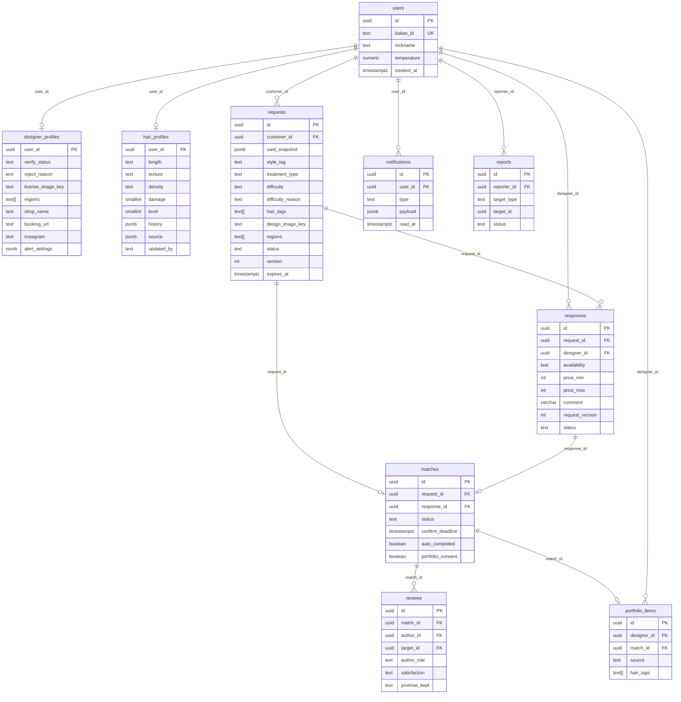

# IROKE v2 DB 구조

2026-11-18 기준 · PostgreSQL (예: Supabase) · 시안 만들기 흐름은 DB 없이 동작하고, [디자이너 구하기]부터 아래 테이블을 씁니다.

## 요약

- 테이블 10개: 피그마 데이터 모델 9개 + `reports`
- 중심 관계: `requests 1 — N responses`, `requests 1 — 0..1 matches`. 후기·인증 작업물은 모두 매칭에 매달림
- 상태값은 Postgres enum 대신 `text + CHECK`로 두어 마이그레이션을 가볍게 함
- 서버가 서비스 키로만 접근하므로 권한 검사는 API(공개 범위 가드)에서 함
- `role` 컬럼 없음. 디자이너 여부는 `designer_profiles` 행이 있는지로 판단 (손님·디자이너 겸업 가능)
- 이미지 컬럼(`…_key`)은 비공개 버킷의 key이고, 모두 얼굴을 가린 사본

## ERD

## 테이블

### users

| 컬럼 | 타입 | 제약 · 설명 |
| --- | --- | --- |
| id | uuid | PK |
| kakao_id | text | UNIQUE, NOT NULL |
| nickname | text | NOT NULL |
| temperature | numeric(4,1) | 기본 36.5. 디자이너는 손님의 결과 만족도, 손님은 디자이너가 남긴 약속 이행(노쇼)으로 계산 |
| created_at | timestamptz | 기본 now() |

### designer_profiles

| 컬럼 | 타입 | 제약 · 설명 |
| --- | --- | --- |
| user_id | uuid | PK, FK → users |
| verify_status | text | `pending` / `verified` / `rejected` |
| reject_reason | text | null |
| license_image_key | text | null. 승인·반려 후 삭제 (면허 번호 컬럼은 없음) |
| submitted_at · verified_at | timestamptz | |
| regions | text[] | 1~2개, '서울 동작구' 형식 문자열, CHECK cardinality ≤ 2 |
| shop_name | text | |
| booking_url | text | https만 |
| instagram | text | null |
| alert_settings | jsonb | `{ enabled, regions, treatmentTypes, difficulties, budgets }` |

### hair_profiles

| 컬럼 | 타입 | 제약 · 설명 |
| --- | --- | --- |
| user_id | uuid | PK, FK → users |
| length | text | `short` / `bob` / `medium` / `long` |
| texture | text | `straight` / `wavy` / `curly` |
| density | text | `low` / `medium` / `high` |
| damage | smallint | 1~5 |
| level | smallint | 1~10, null (현재 밝기) |
| history | jsonb | `[{ type, date }]` 시술 이력 |
| source | jsonb | `{ editedFields, confirmedAt }` |
| updated_by | text | `user` / `match` |
| updated_at | timestamptz | |

### requests

| 컬럼 | 타입 | 제약 · 설명 |
| --- | --- | --- |
| id | uuid | PK |
| customer_id | uuid | FK → users, NOT NULL |
| card_snapshot | jsonb | NOT NULL. styleTag·styleSource·profile·requestText·riskWarnings |
| style_tag | text | 목록·검색용 복사본 |
| treatment_type | text | `cut` / `perm` / `color` / `bleach` (Gemini 산정) |
| difficulty | text | `low` / `medium` / `high` (Gemini 산정) |
| difficulty_reason | text | 난이도 근거 한 줄 (Gemini) |
| hair_tags | text[] | 게시판 표시·필터용 (예: 중단발, 반곱슬) |
| design_image_key | text | NOT NULL, 비공개 버킷 (얼굴 가린 사본) |
| design_hidden_at | timestamptz | null. 마감·취소·완료 때 채움 → 서명 URL 발급 중단 |
| design_consent_at | timestamptz | NOT NULL. “인증 디자이너에게 시안 공개” 동의 시각 |
| regions | text[] | 1~2개, '서울 동작구' 형식 문자열 |
| timing | text | `this_week` / `within_2_weeks` / `within_month` / `any` |
| budget | text | null = 디자이너 제안 |
| status | text | `open` / `matched` / `completed` / `expired` / `cancelled` |
| version | int | 기본 1, 조건 수정·재등록 때 +1 |
| expires_at | timestamptz | NOT NULL, 등록 +7일 |
| created_at · updated_at | timestamptz | |

### responses

| 컬럼 | 타입 | 제약 · 설명 |
| --- | --- | --- |
| id | uuid | PK |
| request_id | uuid | FK → requests |
| designer_id | uuid | FK → users |
| availability | text | `possible` / `conditional` |
| condition | text | `conditional`이면 NOT NULL (CHECK) |
| price_min · price_max | int | 원, CHECK price_min ≤ price_max |
| comment | varchar(50) | |
| request_version | int | 응답 당시 요청 version (“이전 조건” 판단) |
| status | text | `pending` / `accepted` / `not_selected` |
| created_at | timestamptz | |
| (제약) | — | UNIQUE(request_id, designer_id) |

### matches

| 컬럼 | 타입 | 제약 · 설명 |
| --- | --- | --- |
| id | uuid | PK |
| request_id | uuid | FK → requests, UNIQUE (요청당 매칭 1개) |
| response_id | uuid | FK → responses, UNIQUE |
| customer_id · designer_id | uuid | FK → users (조회용 중복) |
| status | text | `accepted` / `complete_requested` / `completed` / `disputed` |
| accepted_at · complete_requested_at · confirmed_at | timestamptz | |
| confirm_deadline | timestamptz | complete_requested_at + 7일. 지나면 배치가 `completed`로 바꿈 |
| auto_completed | boolean | 기본 false. 손님 확인 없이 자동 완료되면 true |
| designer_result_keys | text[] | 완료 요청 때 디자이너가 첨부 |
| customer_result_keys | text[] | 완료 확인 때 손님이 올림 (정면, 옆·뒤 최대 2) |
| portfolio_consent | boolean | 기본 false |
| profile_update | jsonb | 갱신 전후 모발 프로필 (히스토리·되돌리기용) |
| dispute_reason | text | null |

### reviews

| 컬럼 | 타입 | 제약 · 설명 |
| --- | --- | --- |
| id | uuid | PK |
| match_id | uuid | FK → matches |
| author_id · target_id | uuid | FK → users |
| author_role | text | `customer` / `designer` |
| manner | text | `bad` / `ok` / `good` (후기 표시만) |
| promise_kept | text | `yes` / `partly` / `no` (손님이 쓰면 후기 표시만, 디자이너가 쓰면 ‘no’ = 노쇼로 손님 온도 반영) |
| satisfaction | text | `good` / `ok` / `bad`. 손님만 작성, 디자이너 온도 반영 |
| text | varchar(100) | null |
| created_at | timestamptz | |
| (제약) | — | UNIQUE(match_id, author_role) |

### portfolio_items

| 컬럼 | 타입 | 제약 · 설명 |
| --- | --- | --- |
| id | uuid | PK |
| designer_id | uuid | FK → users |
| match_id | uuid | FK → matches, null, UNIQUE (인증 작업물만) |
| source | text | `verified` / `manual` |
| style_tag · treatment_type | text | |
| before_card | jsonb | 인증 작업물의 시술 전 카드(모발 정보) |
| design_key · result_key | text | 얼굴 가린 사본의 key |
| hair_tags | text[] | NOT NULL, 직접 올림은 1개 이상 |
| created_at | timestamptz | |

### notifications

| 컬럼 | 타입 | 제약 · 설명 |
| --- | --- | --- |
| id | uuid | PK |
| user_id | uuid | FK → users |
| type | text | `new_matching_request` / `new_response` / `accepted` / `request_closed` / `deadline_soon` / `complete_requested` / `review_reminder` / `verification_result` |
| payload | jsonb | |
| read_at | timestamptz | null |
| created_at | timestamptz | |

### reports (확장)

| 컬럼 | 타입 | 제약 · 설명 |
| --- | --- | --- |
| id | uuid | PK |
| reporter_id | uuid | FK → users |
| target_type | text | `response` / `portfolio_item` / `user` |
| target_id | uuid | |
| reason | text | |
| status | text | `open` / `resolved` |
| created_at | timestamptz | |

## 상태 전이

| 대상 | 전이 | 계기 |
| --- | --- | --- |
| requests | open → matched | `POST /responses/:id/accept` |
| requests | open → expired | 배치 (expires_at 경과) |
| requests | open → cancelled | `POST /requests/:id/close` |
| requests | expired(응답 0) → open | `POST /requests/:id/reopen` |
| requests | matched → completed | 매칭 completed |
| requests | matched → cancelled | 매칭 disputed |
| responses | pending → accepted · not_selected | 수락 또는 다른 응답 수락·마감 |
| matches | accepted → complete_requested | `POST /matches/:id/complete` |
| matches | complete_requested → completed | `POST /matches/:id/confirm` |
| matches | complete_requested → completed (자동) | 배치 (confirm_deadline 경과, auto_completed = true) |
| matches | complete_requested → disputed | `POST /matches/:id/dispute` |

## 인덱스

- `requests (status, expires_at)` · `requests USING gin (regions)` · `requests (customer_id, created_at DESC)`
- `responses (designer_id, created_at DESC)` — request_id는 UNIQUE로 충분
- `matches (designer_id, status)` · `matches (customer_id, status)`
- `reviews (target_id)` · `portfolio_items (designer_id, source)` · `portfolio_items USING gin (hair_tags)`
- `notifications (user_id, created_at DESC) WHERE read_at IS NULL`

## 피그마 데이터 모델 대비 바꾼 점

| 테이블 | 추가 · 변경 | 근거 화면 |
| --- | --- | --- |
| users | `temperature` 추가 (designer_profiles에서 이동), `role` 제거 (겸업 허용) | WF-12 · D-04 손님 온도 |
| designer_profiles | `reject_reason`, `license_image_key`, `alert_settings` | WF-D1 반려 사유, WF-D2 알림 설정 |
| hair_profiles | `source`, `updated_by` | WF-2 ‘직접 수정’, WF-11 자동 갱신 |
| requests | `style_tag`, `treatment_type`, `difficulty_reason`, `hair_tags`, `version`, `design_hidden_at`, `design_consent_at` | WF-D2 필터·태그, WF-8 “이전 조건”, 공개 범위·동의 정책 |
| responses | `status`, `request_version` | WF-D4 대기·수락·미수락, WF-8 |
| matches | `result_image_key` → 디자이너·손님 배열 2개로 분리, `confirm_deadline`, `auto_completed`, `profile_update`, `dispute_reason`, 상태에서 ‘만료’ 대신 `disputed` | WF-11 정면+옆·뒤, WF-D4 사진 첨부, [아니에요], 자동 완료 |
| reviews | `author_id`·`target_id`, UNIQUE(match_id, author_role), 만족도 온도 반영 | 양방향 온도 |
| portfolio_items | `before_card`, `style_tag`·`treatment_type` | WF-9 시술 전 카드 · “스타일 · 펌” |
| reports | 신규 | X-02 |
